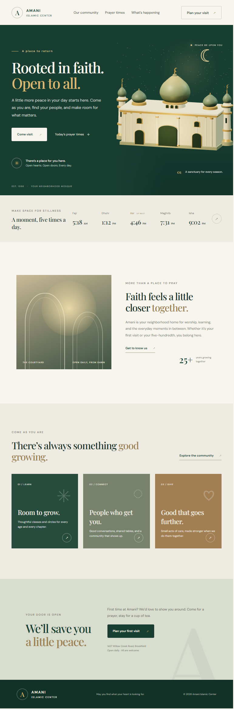

# Amani Islamic Center

A responsive landing page concept for Amani Islamic Center, a welcoming neighborhood mosque. The page combines a calm, editorial-style visual design with a mosque modeled and animated in Three.js.



## Features

- Three.js mosque scene with a central ribbed dome, crescent finials, minarets, arched entrances, facade columns, and architectural lighting.
- Animated night-sky stars that drift and twinkle at different rates.
- Static SVG mosque illustration displayed as a fallback if the Three.js scene cannot initialize.
- Responsive layout with a mobile navigation menu.
- Visit tools to copy the center's address or open it in Google Maps for directions.
- Reduced-motion preference support.
- Local Three.js dependency; the 3D scene does not rely on a CDN.
- Google Fonts are used when available, with system font fallbacks.

## Requirements

- Node.js and npm
- A modern browser with WebGL support (Chrome and Firefox are supported)

## Run locally

Open a terminal in the project directory and install the dependency:

```bash
npm install
```

Start the local development server:

```bash
npm start
```

Open the URL printed by Vite (usually [http://localhost:5173](http://localhost:5173)) in your browser. To stop the server, press `Ctrl+C` in the terminal.

Build the production site with `npm run build`. The generated site is written to `dist/`.

> **Important:** Serve the page over HTTP using `npm start`. Opening `index.html` directly with a `file://` URL prevents the browser from loading the Three.js module, so only the static fallback illustration will appear.

## Deploy to GitHub Pages

The included GitHub Actions workflow builds the site and publishes it to GitHub Pages whenever a commit is pushed to `main`.

1. Push this repository to GitHub.
2. In the repository, open **Settings → Pages**.
3. Under **Build and deployment**, set **Source** to **GitHub Actions**.
4. Open the **Actions** tab and wait for the **Deploy to GitHub Pages** workflow to finish.

Your site will be available at `https://<owner>.github.io/<repository>/`. The workflow bundles Three.js into the production site, and Vite's relative asset paths support the repository subpath used by project Pages sites.

## Project structure

```text
amani-islamic-center/
├── assets/
│   └── mosque-landing.png   Full-page preview screenshot
├── index.html               Page content and SVG fallback artwork
├── package.json             Project metadata, start command, dependency
├── package-lock.json        Locked npm dependency versions
├── script.js                Navigation and Three.js scene
└── styles.css               Layout, responsive styles, and theme
```

## How the 3D scene works

`script.js` imports Three.js from `node_modules/three/build/three.module.js`, creates the mosque geometry, sets up lighting and a WebGL renderer, and starts the animation loop. The dome finial is part of the dome group so it remains attached as the dome animates. Stars are generated in separate particle layers and animated independently.

The page keeps the SVG fallback visible until the first successful Three.js render. If WebGL is unavailable or the local module fails to load, the fallback remains in place. WebGL is required for the interactive 3D scene.

## Customization

- Update page copy, navigation, address, map destination, and fallback artwork in `index.html`.
- Adjust colors, typography, spacing, and breakpoints in `styles.css`.
- Adjust mosque geometry, materials, lighting, star count, and animation in `script.js`.
- Update the local run command or Three.js version in `package.json`.